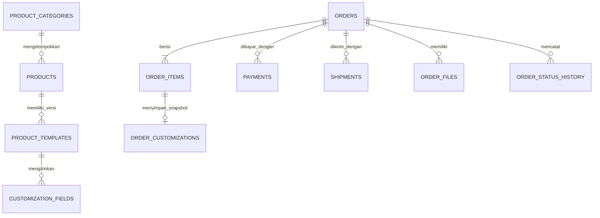

# Rancangan Database Awal

Status: delapan migrasi sudah diuji berurutan pada SQLite sementara dan diterapkan pada D1 production `ruma-store` di APAC. D1 production saat ini hanya berisi skema, tanpa seed demo atau data pesanan.

## Relasi utama

## Keputusan skema

- ID entitas dibuat oleh aplikasi sebagai teks; migrasi tidak membuat ID berurutan yang mudah ditebak.
- Harga disimpan sebagai bilangan bulat rupiah (`IDR`), bukan angka pecahan. Nilai akhir dihitung dan divalidasi Worker.
- Pesanan menyimpan salinan nama, slug, ukuran, harga, dan input custom saat checkout agar perubahan katalog tidak mengubah pesanan lama.
- Template custom memiliki nomor versi. `order_customizations` menyimpan versi yang dipakai ketika pelanggan memesan.
- Migrasi `0008_custom_production_files.sql` menyimpan snapshot definisi field custom saat checkout dan teks DXF kecil yang dibuat admin, lengkap dengan versi, template, serta snapshot nilai personalisasi.
- `idempotency_key` unik mencegah pengiriman ulang request checkout membuat pesanan duplikat.
- Checkout memakai pesanan tamu tanpa akun. Migrasi `0004_shipping_manual_payments.sql` menambah berat produk (default prototipe 500 gram), tujuan/kurir pada snapshot order, serta referensi transfer. Berat default harus diganti setelah produk dan kemasannya ditimbang.
- Status pesanan, produksi, pembayaran, dan pengiriman dikelola terpisah. Perubahan status dapat dicatat dalam `order_status_history`.
- URL media produk disimpan sebagai teks. File bukti transfer disimpan sebagai private file ImageKit; D1 hanya menyimpan ID/path referensi, bukan file blob atau URL publik.
- File DXF teks dibatasi maksimal 256 KiB dan disimpan di D1 untuk prototipe; file besar/biner tidak disimpan di D1. DXF dasar belum menyimpan toolpath mesin.
- Pesanan dan catatan historis memakai `ON DELETE RESTRICT`; jangan menghapus catatan transaksi untuk memperbaiki katalog.
- Tidak ada data produk contoh di dalam migrasi. Harga, ukuran, bahan, foto, dan produk jual yang sebenarnya belum ditetapkan.
- `backend/seeds/demo.sql` berisi data dan harga contoh khusus pratinjau lokal; file itu bukan migrasi dan tidak boleh diterapkan ke cloud.

## Perubahan skema berikutnya

Buat migrasi baru bernomor menggunakan Wrangler; jangan mengedit migrasi yang sudah pernah diterapkan. Sebelum migrasi cloud, pastikan database tujuan dan backup yang benar. Terapkan lebih dulu ke database lokal, lalu tinjau hasilnya sebelum perubahan remote.

## Masih perlu diputuskan

Endpoint review saat ini memakai `ADMIN_TOKEN` bersama sebagai pagar awal. Sebelum dipakai online, tentukan pengelolaan token dan identitas admin individual, masa simpan data pribadi, serta pemulihan akses.
